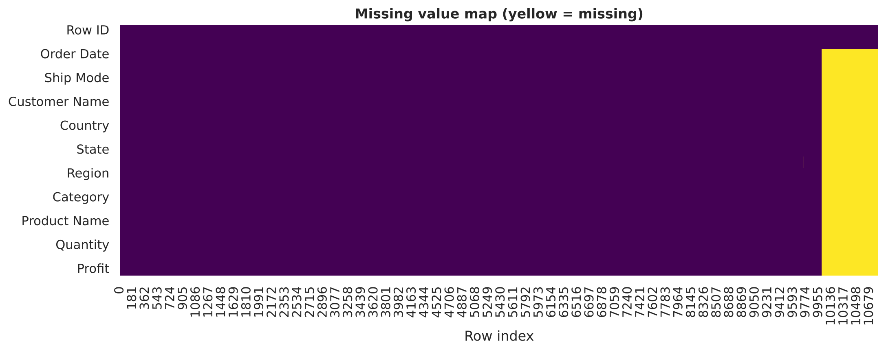
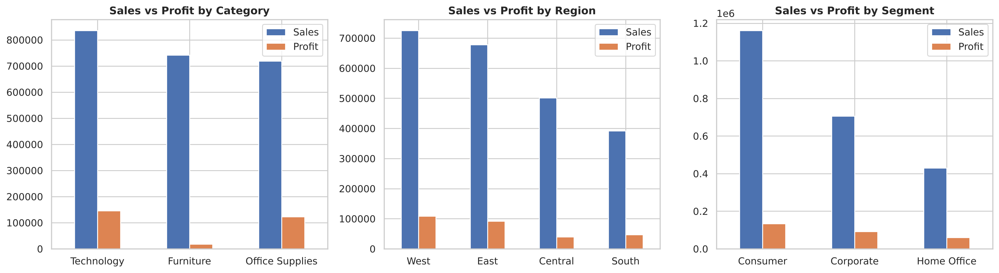
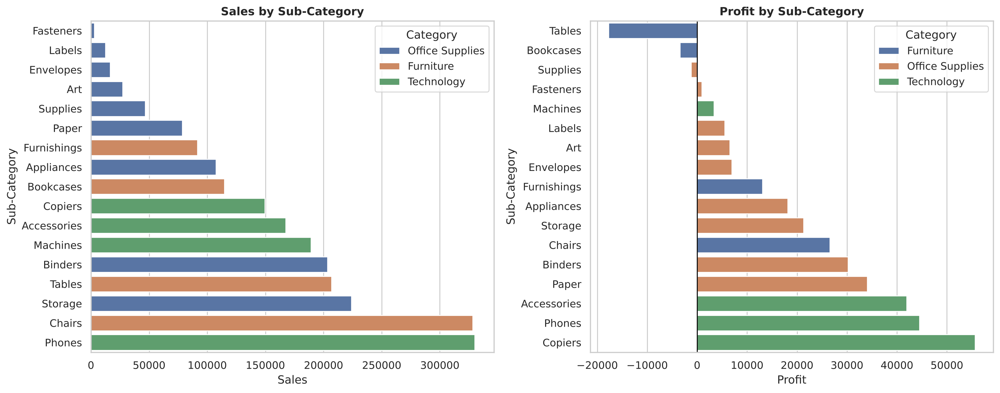
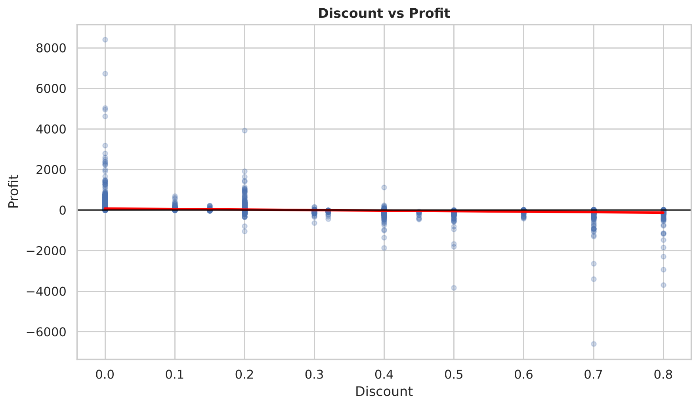
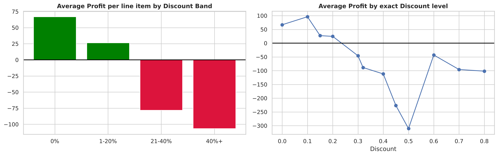
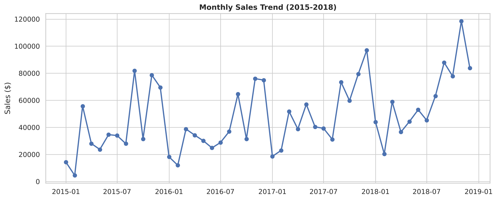
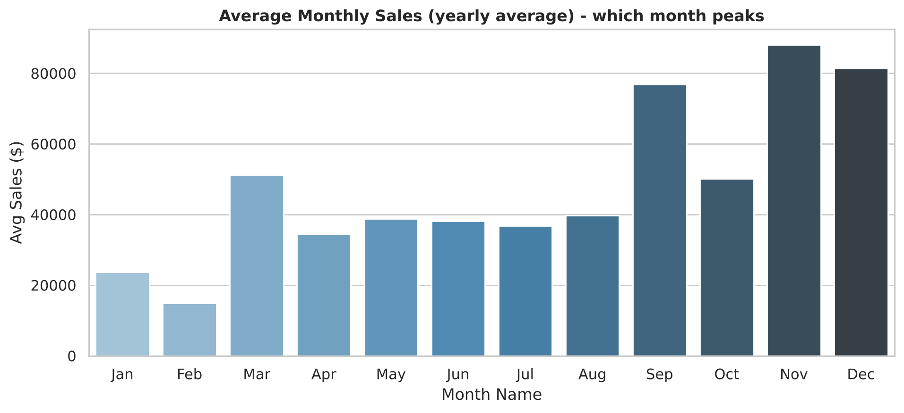
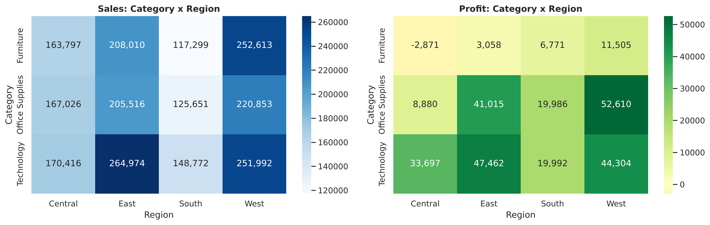

# Superstore Retail Sales: Exploratory Data Analysis

**By MD. Sakib Al Hasan** · [Portfolio](https://sakibzzz641.github.io) · [GitHub](https://github.com/sakibzzz641) · [LinkedIn](https://www.linkedin.com/in/sakibzzz641)

     

An end-to-end EDA of US Superstore retail orders (2015-2018) using **Python (Pandas, Matplotlib, Seaborn)**. The project covers data wrangling, missing-value profiling, and analysis of purchase volume, monthly seasonality, category-wise revenue and discount sensitivity, and ends with five executive takeaways.

## Key Numbers

| Metric | Value |
|---|---|
| Clean orders (line items) | 9,993 |
| Customers | 793 |
| Total sales | $2.30M |
| Total profit | $286K |
| Overall profit margin | 12.5% |

## Business Key Points

| Area | Key Point |
|---|---|
| Top category | Technology leads with $836K sales and $145K profit |
| Weak category | Furniture: $741.7K sales (about 32% of total) but only a 2.5% margin |
| Loss-making sub-categories | Tables (-$17.7K), Bookcases (-$3.5K), Supplies (-$1.2K) |
| Best sub-category | Copiers, with $55.6K profit |
| Discounts | Average profit per line item turns negative above 20% discount (-$78.0 at 21-40%) |
| Seasonality | November, December and September peak; January and February are weakest |
| Growth | Annual sales rose from $484K (2015) to $733K (2018) |
| Regions | West 14.9% margin, East 13.5%, Central only 7.9% |
| Segments | Home Office 14.0%, Corporate 13.0%, Consumer 11.5% |

## Data Cleaning Summary

- The raw file has 10,800 rows, but 806 are junk rows: two unrelated lookup tables (regional managers and returned orders) were appended to the end of the CSV. They were dropped.
- One city (Burlington, Vermont) had a missing postal code, filled with the correct ZIP (05401).
- One exact duplicate line item was removed.
- `Order Date` and `Ship Date` were converted to datetime, and Year, Month, Year-Month, Ship Days and Profit Margin features were created.
- Large Sales/Profit values were checked and kept, since they are genuine large orders.



## Executive Takeaways

**1. Furniture has sales but almost no profit.** Furniture brings $741.7K in sales (about 32% of the total) at only a 2.5% margin, versus roughly 17% for Office Supplies and Technology. Technology is the top earner ($836K sales, $145K profit).



**2. Tables, Bookcases and Supplies lose money.** Tables lose $17.7K despite $207K in sales; Bookcases lose $3.5K and Supplies $1.2K. Copiers are the most profitable sub-category ($55.6K).



**3. Heavy discounts destroy profit.** Average profit per line item is $66.9 with no discount, $26.5 at 1-20%, -$78.0 at 21-40% and -$106.7 above 40%. Average profit turns negative at a 30% discount, and the Discount-Profit correlation is -0.22.




**4. Sales are strongly seasonal.** November (about $88K average), December and September are the peak months; January and February are the weakest. The pattern repeats every year while annual sales grow from $484K (2015) to $733K (2018).




**5. West and East are strong, Central is weak.** West earns a 14.9% margin and East 13.5%, while Central manages only 7.9%. Home Office (14.0%) and Corporate (13.0%) beat the larger Consumer segment (11.5%).



### Recommendations

- Cap discounts at 20% and require approval above that.
- Review pricing and costs for Furniture, especially Tables and Bookcases.
- Build stock and marketing capacity ahead of Q4.
- Audit discounting and product mix in the Central region.

## Repository Structure

```
superstore-sales-eda/
├── data/
│   ├── superstore_sales.csv      # raw dataset
│   └── superstore_clean.csv      # cleaned dataset (generated by the notebook)
├── notebooks/
│   └── superstore_sales_eda.ipynb
├── images/                       # exported charts used in this README
├── requirements.txt
├── .gitignore
├── LICENSE
└── README.md
```

## How to Run

```bash
git clone https://github.com/<your-username>/superstore-sales-eda.git
cd superstore-sales-eda
pip install -r requirements.txt
jupyter notebook notebooks/superstore_sales_eda.ipynb
```

Then choose **Kernel > Restart & Run All**. The notebook finds the CSV automatically.

## Tech Stack

Python, Pandas, NumPy, Matplotlib, Seaborn, Jupyter Notebook

## Author

**MD. Sakib Al Hasan**

Explore my projects, technical skills, and professional profile.

 [](https://github.com/sakibzzz641) [](https://linkedin.com/in/sakibzzz641) [](https://sakibzzz641.github.io/)

---

*If you find this project useful, feel free to
